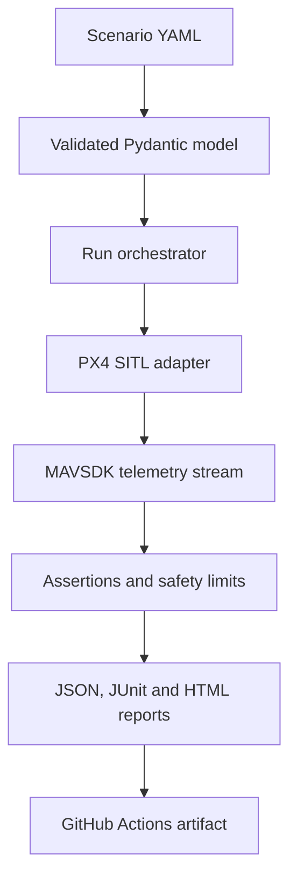

# UAV TestOps — Project Plan

## 1. Product thesis

UAV TestOps is an open-source, developer-first test platform for validating
multirotor mission behavior in simulation. It gives UAV teams a repeatable way
to define flight scenarios, run PX4 SITL, assert safety-critical telemetry
conditions, and publish CI-ready reports.

The first release is a **simulation and validation product only**. It will not
control a real aircraft, provide targeting capabilities, or autonomously execute
real-world missions.

## 2. Why this project

It combines the founder's strongest differentiators:

- Python automation, API testing, CI/CD, and test-platform engineering.
- Aviation planning, weather, navigation, risk management, and pilot judgment.
- Hands-on FPV/UAS familiarity and a desire to work on flight-test systems.

The goal is a portfolio project that can become useful to drone teams while
demonstrating readiness for UAV Flight Test, Systems Integration, V&V, and
Automation roles.

## 3. MVP outcome

A developer can run one command locally or in GitHub Actions to:

1. Launch a pinned PX4 SITL simulation.
2. Execute a declarative scenario through MAVSDK.
3. Collect telemetry and event logs.
4. Assert expected behavior and explicit safety limits.
5. Publish JUnit XML, JSON, and a readable HTML report as artifacts.

### Initial scenarios

| Scenario | Expected validation |
|---|---|
| Pre-arm checks | Vehicle reaches a healthy, armable state only after checks pass. |
| Takeoff and hold | Altitude reaches and remains inside an allowed tolerance band. |
| Low-battery response | Simulator reports the configured failsafe state; the test never assumes a specific action without configuration. |
| Return-to-launch | Vehicle enters return mode and completes the configured simulated behavior. |
| Telemetry interruption | Test records loss/recovery timing and reports the configured system response. |

## 4. Scope boundaries

### In scope

- PX4 SITL first; MAVSDK integration; local Docker-based development.
- Scenario definitions, telemetry assertions, deterministic test fixtures, and reports.
- Flight-log ingestion and basic post-flight validation in a later milestone.
- A public example repository, documentation, and a demo CI pipeline.

### Explicitly out of scope for v1

- Real-aircraft command and control, autonomous navigation, payload control, or weapons-related workflows.
- A ground-control-station replacement.
- A visual mission planner.
- Support for every autopilot before the PX4 flow is reliable.

## 5. Technical decisions

| Area | Choice | Reason |
|---|---|---|
| Language | Python 3.12 | Strongest fit for the existing automation background, pytest, MAVSDK, and data tooling. |
| Test runner | pytest + asyncio | Familiar assertions, fixtures, parallelization, and JUnit output. |
| UAV interface | MAVSDK-Python | High-level, documented interface to PX4 SITL. |
| Simulator | PX4 SITL in Docker | Reproducible local and CI execution. |
| Domain models | Pydantic v2 | Strict validation for scenario YAML and report schemas. |
| Reporting | JSON + JUnit XML + static HTML | Machine-readable CI output plus a recruiter-friendly artifact. |
| CI | GitHub Actions | Runs linting, unit tests, selected SITL scenarios, and uploads reports. |

## 6. Repository structure

```text
uav-testops/
├── README.md
├── PLAN.md
├── pyproject.toml
├── docker-compose.yml
├── .github/workflows/ci.yml
├── src/uav_testops/
│   ├── cli.py                 # Typer commands: validate, run, report
│   ├── models/                # Pydantic scenario and report models
│   ├── orchestration/         # Scenario lifecycle and run coordinator
│   ├── adapters/              # MAVSDK and PX4-specific boundaries
│   ├── assertions/            # Reusable telemetry and state assertions
│   ├── reporting/             # JUnit, JSON, and HTML writers
│   └── safety/                # Run limits, timeouts, and fail-safe guards
├── scenarios/
│   ├── takeoff_hold.yaml
│   ├── return_to_launch.yaml
│   └── telemetry_loss.yaml
├── tests/
│   ├── unit/
│   ├── integration/
│   └── fixtures/
├── docs/
│   ├── architecture.md
│   ├── scenario-authoring.md
│   └── safety-model.md
└── examples/
    └── github-actions/
```

## 7. Architecture



### Design rules

- Keep hardware/autopilot dependencies behind small adapters.
- Each safety assertion is deterministic, bounded by timeouts, and unit-tested.
- Treat telemetry as evidence: retain timestamps, raw values, threshold, and pass/fail rationale.
- Never hide a simulator failure by retrying it automatically; record it clearly.
- Use typed Pydantic models at every external boundary.

## 8. Milestones

### Milestone 0 — Foundation (2–3 days)

- [ ] Initialize repository, `pyproject.toml`, Ruff, mypy, pytest, and pre-commit.
- [ ] Add Docker Compose with a pinned PX4 SITL image/version.
- [ ] Write `README.md` with one-command local setup and project safety boundaries.
- [ ] Add GitHub Actions for linting and unit tests.

**Exit criterion:** a clean clone passes formatting, typing, and unit tests.

### Milestone 1 — Vertical slice (1 week)

- [ ] Define the Pydantic schema for a basic takeoff-and-hold scenario.
- [ ] Start/stop SITL through one adapter.
- [ ] Connect through MAVSDK and capture position, altitude, battery, and flight mode.
- [ ] Implement one takeoff-and-hold assertion with explicit timeout/tolerance.
- [ ] Export JSON and JUnit XML.

**Exit criterion:** `uav-testops run scenarios/takeoff_hold.yaml` produces a passing or failing report reliably.

### Milestone 2 — Scenario engine (1–2 weeks)

- [ ] Add declarative steps, preconditions, expected states, and safety limits.
- [ ] Implement reusable assertions for flight mode, altitude band, position distance, and event deadline.
- [ ] Add return-to-launch and telemetry-interruption scenarios.
- [ ] Generate a static HTML report with telemetry timeline and failure evidence.

**Exit criterion:** three scenarios run through CI and publish artifacts.

### Milestone 3 — Portfolio-grade release (1 week)

- [ ] Add a 3–5 minute narrated demo showing a passing run and an intentional failure.
- [ ] Publish architecture and scenario-authoring docs.
- [ ] Add issue templates, contribution guide, license, and release notes.
- [ ] Create a concise case study for LinkedIn and the UAV-focused CV.

**Exit criterion:** an outside developer can reproduce the demo from the README.

### Milestone 4 — Validation analytics (later)

- [ ] Ingest PX4 `.ulg` logs and normalize selected signals.
- [ ] Compare runs against saved baselines and flag regression candidates.
- [ ] Add an ArduPilot adapter only after the PX4 contract tests are mature.

## 9. Git workflow

- Protect `main`; merge through reviewed pull requests only.
- Branch format: `feat/<short-name>`, `fix/<short-name>`, `docs/<short-name>`.
- Use Conventional Commits, e.g. `feat(scenarios): add rtl validation`.
- Every PR must pass formatting, linting, static typing, unit tests, and relevant integration tests.
- Keep commits small and independently reversible; avoid mixing refactors with behavior changes.
- Tag usable milestones as `v0.1.0`, `v0.2.0`, and so on.

## 10. Quality gates

| Gate | Minimum rule |
|---|---|
| Code quality | Ruff and mypy pass with no ignored new violations. |
| Unit coverage | Cover all scenario parsing, assertion evaluation, and report generation paths. |
| Integration | Each supported scenario runs in SITL in CI. |
| Evidence | A failed assertion identifies expected value, observed value, timestamps, and scenario step. |
| Reproducibility | PX4 and Python dependencies are pinned; test seed/configuration is persisted in the report. |
| Safety | No production path connects to a physical vehicle in v1. |

## 11. Backlog after v0.1

- Scenario matrix for weather-like simulation variables, sensor degradation, and communication degradation.
- Flight-log review UI backed by the existing web/React experience.
- Report comparison for regressions between two CI runs.
- Hardware-in-the-loop support only with an explicit physical-safety review and isolated lab procedure.
- Optional companion repository with curated, anonymized demo logs.

## 12. First issue set

1. `chore: bootstrap Python package and developer tooling`
2. `build: add pinned PX4 SITL Docker Compose environment`
3. `feat(models): validate takeoff-and-hold scenario YAML`
4. `feat(adapter): implement bounded MAVSDK SITL connection`
5. `feat(assertions): validate altitude band and hold duration`
6. `feat(reporting): emit JUnit and JSON run reports`
7. `ci: run unit tests and upload report artifacts`
8. `docs: publish architecture, safety model, and quickstart`

## 13. Definition of success

Within six weeks, the repository demonstrates a reliable, polished answer to:

> “How would you automate validation of UAV behavior before the system reaches the field?”

That answer should be visible in the code, the CI artifacts, a short demo, and a
CV bullet — not only in a presentation.
